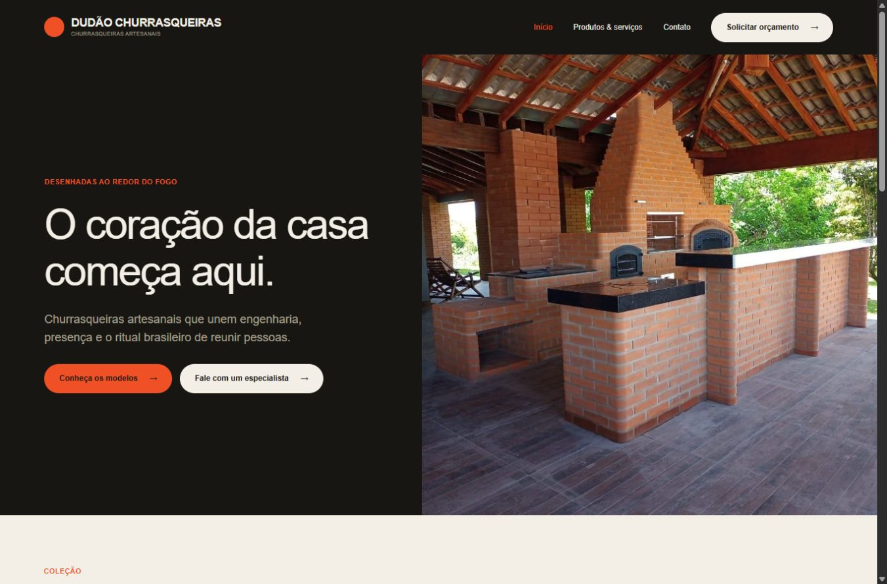
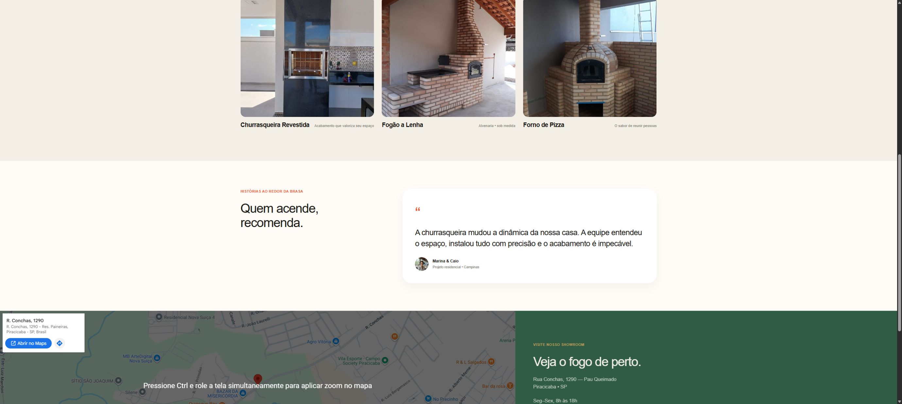

# Dudão Churrasqueiras

Site institucional em PHP e Bootstrap, desenvolvido a partir das telas do Figma fornecidas em PDF e PNG, para apresentar a Dudão Churrasqueiras, de Piracicaba — SP.

## Objetivo do projeto

Divulgar churrasqueiras artesanais, fogões a lenha, fornos e serviços de montagem. O site permite conhecer os modelos, localizar o showroom no Google Maps e preparar uma solicitação de orçamento para enviar pelo WhatsApp.

## Integrantes do grupo

- Francisco José Marcon Médicci
- João Pedro Gomes Médici
- Lucas Henrique Delvage
- Matheus Guilherme Gerage
- Cauã Farias Camargo

## Tecnologias utilizadas

| Tecnologia | Utilização |
| --- | --- |
| PHP | Renderização das páginas, componentes compartilhados e validação do formulário. |
| HTML5 | Estrutura semântica das páginas e formulários. |
| CSS3 | Identidade visual, espaçamentos e adaptação responsiva. |
| Bootstrap 5.3.8 | Grade responsiva, formulários, menu móvel e modais. |
| JavaScript do Bootstrap | Interação dos componentes com o bundle oficial incluído no projeto. |
| Google Maps | Mapa incorporado e acesso às rotas do showroom. |
| Links do WhatsApp | Abertura da conversa com a solicitação preenchida. |

## Principais funcionalidades

- **Início:** apresentação, coleção de produtos, depoimento e showroom.
- **Produtos e serviços:** catálogo, detalhes em modais e informações de montagem.
- **Orçamento por produto:** seleção de modelo que preenche a mensagem do formulário.
- **Contato:** campos para nome, telefone, e-mail, cidade, ambiente e mensagem.
- **Validação em PHP:** campos obrigatórios, telefone, e-mail e consentimento.
- **Revisão da solicitação:** apresentação dos dados antes de continuar no WhatsApp.
- **Mapa interativo:** Google Maps ao lado do endereço, com botão para abrir a localização.
- **Responsividade:** adaptação para computadores e celulares, incluindo menu recolhível.
- **Proteções do formulário:** token CSRF, campo antirrobô e escape de dados na saída HTML.

## Requisitos e dependências

- PHP **8.2 ou superior**, com suporte a sessões e permissão de gravação no diretório de sessões configurado pelo servidor.
- Servidor com suporte a PHP: servidor embutido para desenvolvimento, XAMPP/Apache ou hospedagem PHP equivalente.
- Navegador atualizado, com JavaScript habilitado para menu móvel e modais.
- Internet para carregar o Google Maps e acessar o WhatsApp.

O Bootstrap e as imagens estão incluídos localmente. Não é necessário instalar Node.js, npm, Composer ou banco de dados. Não há etapa de compilação.

## Instalação e execução

### Opção 1 — Servidor embutido do PHP

1. Baixe e extraia o ZIP do projeto ou obtenha uma cópia do repositório.
2. Abra o terminal na pasta `dudao-php`, onde está o arquivo `index.php`.
3. Verifique se o PHP está disponível:

   ```sh
   php -v
   ```

4. Inicie o servidor de desenvolvimento:

   ```sh
   php -S localhost:8080
   ```

5. Abra [http://localhost:8080](http://localhost:8080).
6. Para encerrar, pressione `Ctrl+C` no terminal.

Se o comando `php` não for reconhecido, instale o PHP ou adicione a pasta do executável ao `PATH`. O servidor embutido serve para desenvolvimento e testes locais.

### Opção 2 — XAMPP no Windows

1. Instale uma versão do XAMPP com PHP 8.2 ou superior.
2. Copie a pasta `dudao-php` para `htdocs`, por exemplo: `C:\xampp\htdocs\dudao-php`.
3. No painel do XAMPP, inicie o **Apache**. O MySQL não é necessário.
4. Abra [http://localhost/dudao-php/](http://localhost/dudao-php/).

Os arquivos `.php` precisam ser executados pelo servidor. Abrir `index.php` diretamente pelo explorador de arquivos não executa o site corretamente.

## Configuração

As informações da empresa e do catálogo estão em [`includes/config.php`](includes/config.php).

| Constante | Valor atual | Finalidade |
| --- | --- | --- |
| `BUSINESS_NAME` | Dudão Churrasqueiras | Nome da empresa. |
| `BUSINESS_PHONE` | (19) 99655-9994 | Telefone exibido. |
| `BUSINESS_WHATSAPP` | 5519996559994 | Número internacional, apenas com dígitos, usado nos links. |
| `BUSINESS_EMAIL` | contato@dudao.com.br | E-mail exibido e usado nos links `mailto:`. |
| `BUSINESS_CITY` | Piracicaba • SP | Cidade exibida. |
| `BUSINESS_ADDRESS` | Rua Conchas, 1290 — Pau Queimado | Endereço do showroom. |

Edite os arrays `$products` e `$collection` para alterar os modelos e textos. As fotografias estão em `assets/img/`, e o horário de atendimento está em `index.php`.

Ao mudar a cidade, atualize também os parâmetros dos links do mapa e de rotas em `index.php`, que incluem explicitamente Piracicaba — SP.

### Formulário e e-mail

**A versão atual encaminha a solicitação para o WhatsApp; não envia e-mails automaticamente.**

1. O visitante preenche o formulário em `contato.php`.
2. O PHP valida os dados e o consentimento.
3. Uma tela apresenta a solicitação para revisão.
4. O botão **Continuar no WhatsApp** abre a conversa com a mensagem preenchida.
5. O visitante confirma o envio dentro do WhatsApp.

O e-mail do visitante é incluído na mensagem. O aplicativo não grava os dados do formulário em banco ou arquivos e não verifica a entrega da mensagem pelo WhatsApp.

Configurar `BUSINESS_EMAIL` não cria uma caixa de e-mail nem habilita envios automáticos. O envio direto por e-mail exigiria implementação adicional e configuração de um serviço de envio, como SMTP; essa funcionalidade não está incluída nesta versão.

## Publicação em hospedagem

1. Utilize uma hospedagem com PHP 8.2 ou superior e suporte a sessões.
2. Envie `index.php`, `produtos.php`, `contato.php`, `includes/` e `assets/` para a pasta pública, normalmente `public_html` ou `www`.
3. Confirme os contatos em `includes/config.php` e habilite HTTPS no domínio.
4. Confira as páginas, o formulário, os links e o carregamento do mapa.

Não é necessário enviar `docs/` e `README.md` para executar o site; esses arquivos documentam o projeto. Não há migração de banco de dados nem instalação de pacotes no servidor.

## Estrutura do projeto

```text
dudao-php/
├── index.php                  # Início e showroom
├── produtos.php               # Catálogo, modais e montagem
├── contato.php                # Formulário, validação e revisão
├── includes/
│   ├── config.php             # Contatos, produtos e funções auxiliares
│   ├── header.php             # Cabeçalho e navegação compartilhados
│   └── footer.php             # Rodapé compartilhado
├── assets/
│   ├── css/style.css          # Estilos personalizados
│   ├── img/                   # Fotografias do projeto
│   ├── vendor/bootstrap/      # CSS, JavaScript e licença do Bootstrap
│   └── favicon.svg            # Ícone do site
├── docs/imagens/              # Capturas de tela para documentação
└── README.md                  # Apresentação e instruções
```

## Imagens e exemplos de funcionamento

### Página inicial

Apresentação da marca, fotografia do conjunto de churrasqueira e botões de acesso ao catálogo e ao atendimento.



### Showroom com Google Maps

Mapa interativo ao lado do endereço e do horário, com opção de abrir a localização no Google Maps.



### Exemplo de solicitação de orçamento

1. Abra **Produtos & serviços**.
2. Escolha um modelo e clique em **Ver detalhes**.
3. Clique em **Quero este modelo** para abrir o formulário com o modelo indicado na mensagem.
4. Preencha os dados e marque o consentimento.
5. Clique em **Preparar solicitação** e confira a revisão.
6. Clique em **Continuar no WhatsApp** e confirme o envio no aplicativo, caso queira entrar em contato com a empresa.

Para testes, utilize dados fictícios e pare na revisão, sem enviar mensagens ao número da empresa.

## Verificações realizadas

- Sintaxe dos arquivos PHP validada com PHP 8.4.27.
- Respostas HTTP 200 nas três páginas e nos arquivos estáticos utilizados.
- Menu móvel, navegação, modal de produto e seleção de modelo verificados no navegador.
- Layout inspecionado em larguras de 390 px e 1366 px.
- Formulário testado com solicitação válida, saída HTML escapada, token CSRF inválido, e-mail inválido e consentimento ausente.
- Carregamento do Google Maps conferido após a substituição do mapa ilustrativo.
- Nenhuma mensagem de teste enviada ao WhatsApp.

## Créditos

O layout, as fotografias e os textos de referência foram fornecidos para o projeto. O endereço, os horários e o depoimento seguem o material recebido, com os contatos e a cidade atualizados conforme as informações fornecidas.

O [Bootstrap](https://getbootstrap.com/) é distribuído sob a [licença MIT](assets/vendor/bootstrap/LICENSE). Google Maps e WhatsApp são serviços externos e dependem de disponibilidade e conexão com a internet.

## Entrega acadêmica — PIC I

O prazo informado para a entrega final é **23 de novembro de 2026**. Consulte o [checklist e roteiro de apresentação](docs/ENTREGA-PIC-I.md). O vídeo deverá ser gravado pelos cinco integrantes, com câmera aberta durante suas respectivas apresentações e explicação da contribuição real de cada um.
